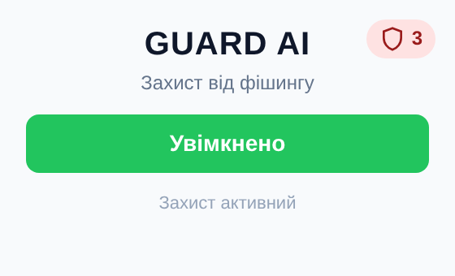
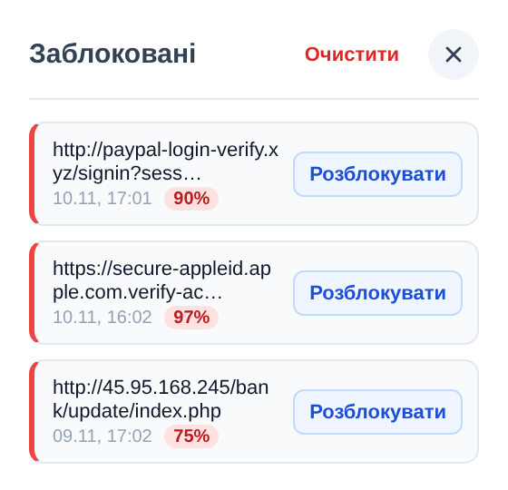
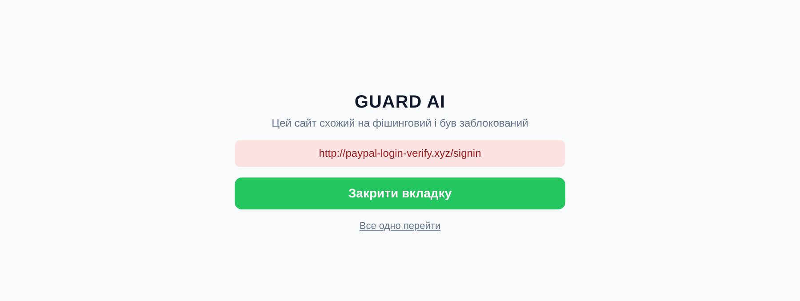
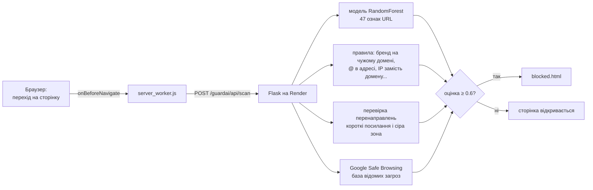
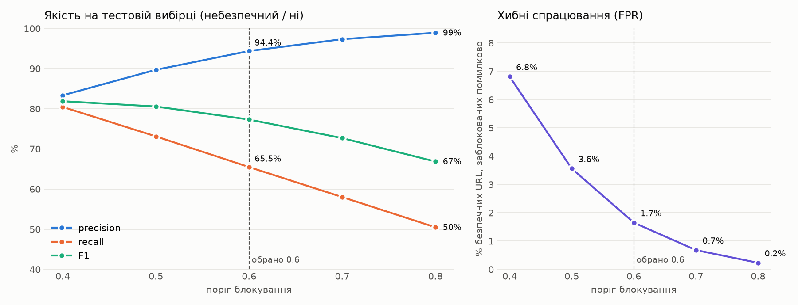
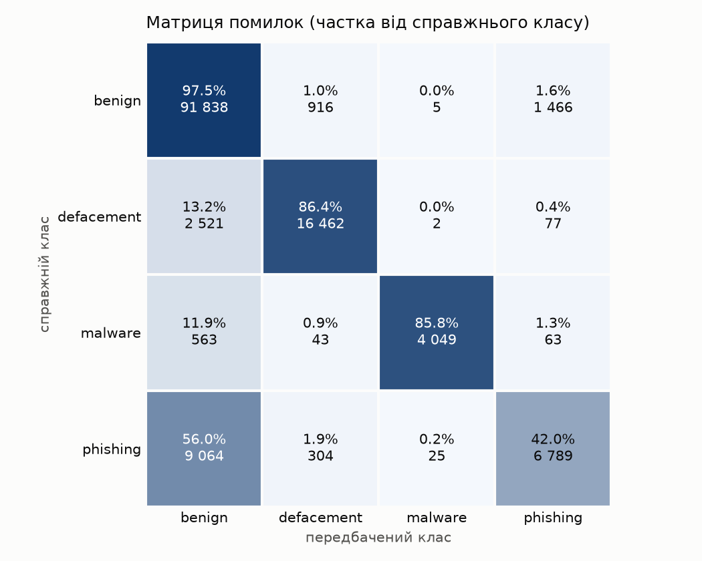
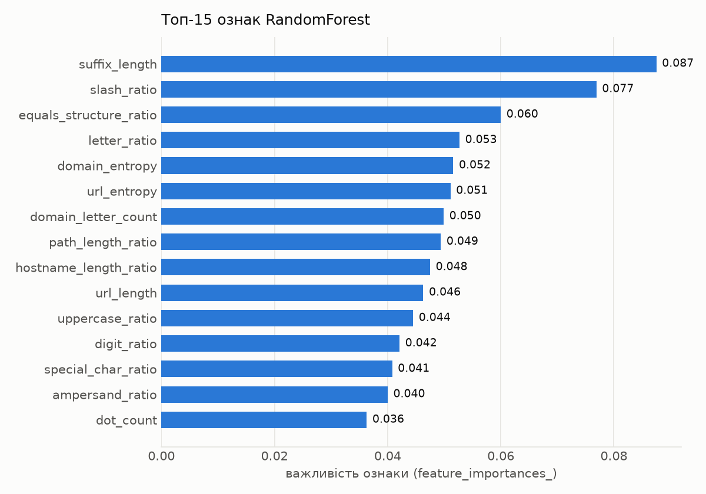
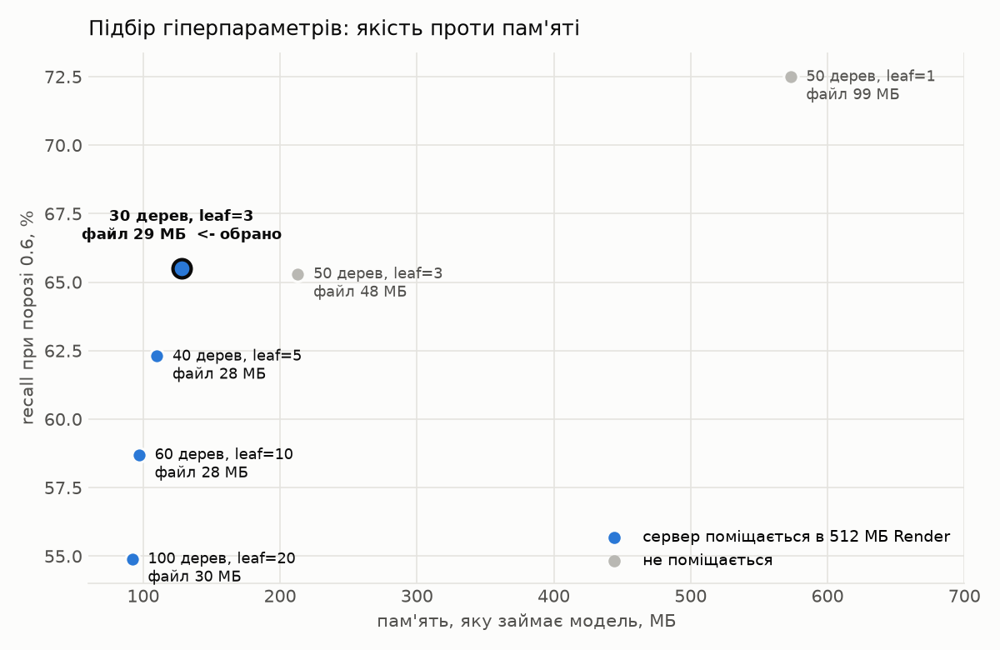

# GUARD AI


Розширення для Chrome і Firefox, яке захищає від фішингу. Кожен URL перед завантаженням сторінки
перевіряється сервером: модель машинного навчання (RandomForest) + правила для очевидних
ознак фішингу. Якщо сайт небезпечний, замість нього відкривається сторінка-попередження.

Курсова робота.

<p>
  
  &nbsp;
  
</p>


## Як це працює



Підсумкова оцінка — максимум з оцінок моделі, правил і (за потреби) кінцевої адреси
після перенаправлень. Якщо URL є в базі Google Safe Browsing — 1.0. Сайт блокується
при оцінці ≥ 0.6.

На спільних хостингах (`github.io`, `vercel.app`, `pages.dev`...) адреси фішингу й
звичайного сайту однакові, тому там оцінка моделі не враховується — працюють правила
і Safe Browsing.

## Результати

| Метрика | Значення |
|---|---|
| ROC-AUC (безпечний / небезпечний) | 0.955 |
| Precision / recall при порозі 0.6 | 0.944 / 0.655 |
| Хибні тривоги на незнайомих популярних сайтах | 1.5% |
| Розмір моделі / пам'ять сервера | 29 МБ / ~440 МБ |



| Матриця помилок | Топ-15 ознак |
|---|---|
|  |  |



Повні метрики — у [`backend/training_metrics.txt`](backend/training_metrics.txt).

## Структура

```
backend/
  app.py                      Flask-сервер, API /guardai/api/scan
  check_isPhishing.py         модель + правила + перевірка перенаправлень
  check_rules.py              правила поверх моделі
  check_ssl_and_redirects.py  перехід по перенаправленнях (із захистом від SSRF)
  safebrowsing.py             перевірка в базі Google Safe Browsing
  tests/test_guard.py         тести (pytest)
  training_metrics.txt        метрики останнього навчання
  ml/
    extract_features.py       нормалізація URL і 47 ознак
    train_GUARD.py            навчання моделі
    augment_benign.py         генерація benign-URL зі списку популярних сайтів Tranco
    draw_charts.py            графіки за training_metrics.txt -> ml/charts/
    coursework.pkl            навчена модель
    malicious_phish_cleaned.csv   датасет (642 861 URL, 4 класи)
    tranco_benign.csv         47 880 benign-URL популярних сайтів
extension/
  manifest.json
  server_worker.js            перевірка URL, блокування, кеш, білий список
  frontend/
    popup.html / .js / .css   попап: увімкнення, панель заблокованих сайтів
    blocked.html / .js        сторінка-попередження
docs/                         скриншоти для README
```

## Встановлення розширення

**Chrome:**

1. Відкрити `chrome://extensions`
2. Увімкнути «Режим розробника»
3. «Завантажити розпаковане» → вибрати папку `extension/`

**Firefox (128+):**

1. Відкрити `about:debugging#/runtime/this-firefox`
2. «Тимчасово завантажити додаток» → вибрати `extension/manifest.json`

Тимчасовий додаток зникає після перезапуску Firefox; для постійного встановлення
його треба підписати на addons.mozilla.org.

Розширення звертається до сервера на Render (`server_worker.js`, адреса
`coursework-ysbi.onrender.com`). Для локального сервера змінити адресу на
`http://localhost:5000/guardai/api/scan`.

## Запуск сервера локально

```bash
cd backend
python -m venv venv
source venv/bin/activate        # Windows: venv\Scripts\activate
pip install -r requirements.txt
python app.py                   # http://localhost:5000
```

Ключ Google Safe Browsing (необов'язково — без нього ця перевірка просто пропускається):
створити ключ у Google Cloud Console (APIs & Services → Credentials, обмежити до
«Safe Browsing API») і покласти в `backend/.env`:

```
GSB_API_KEY=ваш_ключ
```

`.env` є в `.gitignore` і в репозиторій не потрапляє. На Render ключ задається в
Environment → `GSB_API_KEY`.

Перевірка:

```bash
curl -X POST http://localhost:5000/guardai/api/scan \
  -H "Content-Type: application/json" \
  -d '{"url": "http://paypal-login-verify.xyz/signin"}'
```

Відповідь:

```json
{
  "status": "success",
  "url": "http://paypal-login-verify.xyz/signin",
  "is_phishing": true,
  "probability": 0.9,
  "threat_type": "phishing",
  "reasons": ["назва бренду 'paypal' на чужому домені paypal-login-verify.xyz", "..."]
}
```

Версії бібліотек у `requirements.txt` зафіксовані: `coursework.pkl` завантажується лише
тією версією scikit-learn, якою модель навчена (1.9.0).

## Тести

```bash
cd backend
pip install pytest
python -m pytest tests -q
```

40 тестів: ознаки, правила, сайти на хостингах, захист від SSRF, підсумкова перевірка,
API (зокрема обмеження частоти запитів). Мережеві перевірки підмінено заглушками — тести
не звертаються до Google і працюють без інтернету.

## Повторне навчання моделі

```bash
cd backend
# 1. Список популярних сайтів: https://tranco-list.eu/top-1m.csv.zip -> розпакувати top-1m.csv
python ml/augment_benign.py шлях/до/top-1m.csv   # -> ml/tranco_benign.csv
# 2. Навчання (~2 хв)
python ml/train_GUARD.py                          # -> ml/coursework.pkl, training_metrics.txt
# 3. Графіки (потрібен matplotlib, лише локально)
python ml/draw_charts.py                          # -> ml/charts/*.png
```

## Обмеження

- Аналізується лише рядок URL, не вміст сторінки. Датасет зібрано у 2021 році: на свіжому
  фішингу (PhishTank, листопад 2026) модель разом із правилами ловить ~10%. Більшість
  сучасного фішингу розміщено на спільних хостингах, де за адресою його не відрізнити, —
  тут допомагає Google Safe Browsing.
- API обмежено до 60 запитів на хвилину і 1000 на добу з однієї IP-адреси (далі — відповідь 429).
  Локально це працює, але на Render ліміт поки не спрацьовує (ймовірно, через проксі
  перед сервером). URL довший за 2048 символів не приймається (400), тіло запиту більше
  16 КБ — (413).
- Безкоштовний Render засинає після 15 хв простою і прокидається 30–60 с; у цей час
  перевірка не встигає (таймаут 5 с) і сторінки відкриваються без неї.
- Усі відвідувані URL (крім білого списку) надсилаються на сервер.
